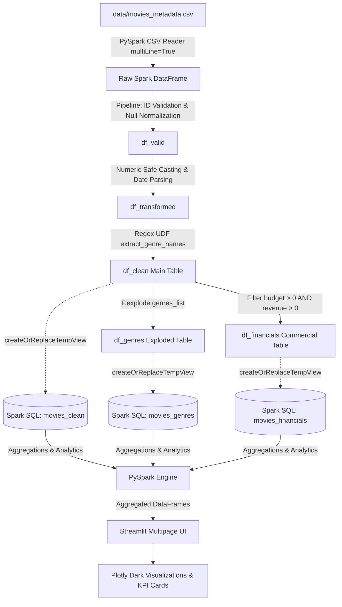

# CineScope — Movie Performance Analytics
### Apache Spark & Streamlit Distributed Big Data Analytics Platform

[](https://spark.apache.org/)
[](https://www.python.org/)
[](https://streamlit.io/)
[](https://plotly.com/)
[](#)

---

## 1. Project Overview

**CineScope** is a high-performance big data analytics platform engineered with **Apache Spark (PySpark)** and **Streamlit**. The platform analyzes **45,466 feature films** from the Kaggle Movies Dataset, combining distributed data transformations, **Spark SQL** for analytical queries, and a modern cinematic dark-themed dashboard with interactive **Plotly** visualizations.

Unlike static dashboards or simple prototypes, CineScope executes actual PySpark DataFrame transformations and Spark SQL queries over real-world data, demonstrating industrial big data engineering practices.

---

## 2. Problem Statement & Objectives

### Problem Statement
The film industry generates massive multidimensional data spanning box office revenues, multi-million dollar budgets, diverse audience ratings, and complex genres. Analyzing 45,000+ titles with nested JSON fields and reporting anomalies in traditional single-threaded tools (such as plain Pandas or spreadsheets) encounters memory limitations, slow execution, and fragile parsing.

### Core Objectives
1. **Distributed Data Processing**: Ingest and clean 45,000+ movie records using Apache Spark's resilient DataFrame engine.
2. **Robust Preprocessing Pipeline**: Handle unescaped newlines, shifted rows, cast errors, unparseable dates, and nested JSON structures.
3. **Relational Normalization**: Explode multi-genre JSON arrays into normalized movie-genre relationships for accurate genre analytics.
4. **Financial & Commercial Modeling**: Compute estimated Profit and Return on Investment (ROI) while guarding against zero/unreported budget distortions.
5. **Interactive Business Intelligence**: Provide multi-attribute search, longitudinal timeline trends, audience sentiment analysis, and a live Spark SQL console.

---

## 3. Dataset Description & Schema

The workspace utilizes the Kaggle **"The Movies Dataset"** (collected from TMDB and GroupLens), situated in `data/`:

| File Name | Size | Records | Description |
| :--- | :--- | :--- | :--- |
| `movies_metadata.csv` | **34.45 MB** | **45,466** | Primary catalog: title, budget, revenue, ratings, runtime, release date, genres |
| `ratings_small.csv` | 2.44 MB | 100,006 | 100k audience ratings for collaborative analysis |
| `credits.csv` | 189.92 MB | 45,478 | Full cast and crew credits |
| `keywords.csv` | 6.23 MB | 45,479 | Plot keywords |

### Real PySpark Ingested & Cast Schema
- `movie_id`: `LongType` (Validated numeric movie identifier)
- `title_clean`: `StringType` (Coalesced and trimmed movie title)
- `budget_num`: `DoubleType` (Production budget in USD; 0 denotes unreported)
- `revenue_num`: `DoubleType` (Worldwide gross box office in USD; 0 denotes unreported)
- `profit`: `DoubleType` (Derived: `revenue_num - budget_num` for positive values)
- `roi`: `DoubleType` (Derived: `((revenue - budget) / budget) * 100` for budget > 0)
- `vote_avg`: `DoubleType` (Audience score on 0.0 - 10.0 scale)
- `vote_cnt`: `LongType` (Total number of audience ratings submitted)
- `popularity_num`: `DoubleType` (TMDB logarithmic popularity index)
- `runtime_num`: `DoubleType` (Feature film duration in minutes)
- `release_date_parsed`: `DateType` (Parsed from ISO `yyyy-MM-dd`)
- `release_year`: `IntegerType` (Extracted release year)
- `genres_list`: `ArrayType(StringType)` (Normalized array of genre names)
- `genres_display`: `StringType` (Comma-separated string for UI presentation)
- `poster_path`: `StringType` (TMDB CDN path for high-res movie posters)

---

## 4. System Architecture & Workflow



---

## 5. Technology Stack

- **Data Processing**: Apache Spark 3.5 / PySpark DataFrame API
- **SQL Engine**: Apache Spark SQL
- **Web Frontend**: Streamlit (Python 3.10+)
- **Visualization**: Plotly Express & Plotly Graph Objects
- **Data Interchange**: Pandas (for small aggregated result sets) & PyArrow
- **Automated Testing**: Pytest
- **Java Runtime**: Java SE Runtime 8, 11, or 17 (64-bit)

---

## 6. Project Directory Structure

```
Movie-Performance-Analysis/
├── .streamlit/
│   └── config.toml             # Custom dark cinematic theme tokens
├── data/
│   ├── movies_metadata.csv     # Primary dataset (34.45 MB)
│   ├── ratings_small.csv       # Audience ratings sample
│   ├── credits.csv             # Cast and crew credits
│   └── keywords.csv            # Plot keywords
├── src/
│   ├── __init__.py             # Package initializer
│   ├── config.py               # Paths, theme colors, and thresholds
│   ├── spark_session.py        # SparkSession manager with auto-Java detection
│   ├── data_loader.py          # PySpark CSV reader with multiline options
│   ├── preprocessing.py        # Spark cleaning, casting, and exploding pipeline
│   ├── analytics.py            # Aggregations, rankings, and dynamic insights
│   ├── visualizations.py       # Plotly chart generators & HTML components
│   ├── ui_helpers.py           # Streamlit CSS styling and cached pipeline
│   └── utils.py                # Number, currency, and date formatting helpers
├── pages/
│   ├── 1_Overview.py           # High-level KPIs, distributions, and insights
│   ├── 2_Movie_Explorer.py     # Multi-filter search, poster cards, CSV export
│   ├── 3_Genre_Analysis.py     # Normalized exploded genre analytics & heatmaps
│   ├── 4_Revenue_Budget.py     # Financial modeling, ROI, box office disconnects
│   ├── 5_Ratings_Popularity.py # Audience sentiment, vote thresholds, correlations
│   ├── 6_Trends_Over_Time.py   # Historical timeline analysis (1920-2020)
│   ├── 7_Data_Quality.py       # Data engineering audit & live Spark SQL console
│   └── 8_About_Project.py      # Architecture, technical specs, and lab details
├── tests/
│   ├── __init__.py
│   ├── test_preprocessing.py   # Tests for casting, dates, and genre explosion
│   └── test_analytics.py       # Tests for KPIs, rankings, and financial models
├── app.py                      # Main entrypoint and navigation hub
├── requirements.txt            # Python dependencies
├── .gitignore                  # Git exclusions for Spark metastore, cache, etc.
└── README.md                   # Complete documentation
```

---

## 7. Setup & Installation Instructions

### Prerequisites
1. **Python**: Python 3.10, 3.11, 3.12, 3.13, or 3.14.
2. **Java**: 64-bit Java Runtime Environment (JRE/JDK 8, 11, or 17).
   - *Check Java installation*: `java -version`

### Step 1: Create Virtual Environment
```powershell
# Windows PowerShell
python -m venv .venv
.venv\Scripts\Activate.ps1
```
```bash
# macOS / Linux
python3 -m venv .venv
source .venv/bin/activate
```

### Step 2: Install Dependencies
```bash
python -m pip install --upgrade pip
pip install -r requirements.txt
```

### Step 3: Launch CineScope Application

**Quickest Option (Double-Click or Run Batch):**
- In Windows Explorer or terminal, simply run:
  ```cmd
  run_app.bat
  ```

**PowerShell:**
```powershell
$env:JAVA_HOME = "C:\Program Files\Java\jre1.8.0_202"
$env:PATH = "C:\Program Files\Java\jre1.8.0_202\bin;$env:PATH"
py -3.14 -m streamlit run app.py
```

**Command Prompt (cmd.exe):**
```cmd
set "JAVA_HOME=C:\Program Files\Java\jre1.8.0_202"
set "PATH=%JAVA_HOME%\bin;%PATH%"
py -3.14 -m streamlit run app.py
```

The dashboard will open automatically in your browser at `http://localhost:8501`.


---

## 8. Analytical Highlights & Spark Transformations

### 1. Genre Normalization via PySpark Explode
Raw movie genres exist in single-quoted JSON arrays: `[{'id': 16, 'name': 'Animation'}, {'id': 35, 'name': 'Comedy'}]`.
CineScope uses a PySpark UDF with compiled regex to extract genre names into an `ArrayType(StringType())`, followed by:
```python
df_genres_exploded = df_clean.withColumn("genre", F.explode(F.col("genres_list"))).filter(F.col("genre") != "")
```
This enables granular genre-by-genre aggregations across revenue, ratings, and budgets without losing multi-genre associations.

### 2. Guarded Financial Modeling (Profit & ROI)
Unreported budgets and box office receipts are represented as 0 in raw datasets. CineScope uses guarded conditional Spark columns:
```python
valid_financials = (F.col("budget_num") > 0) & (F.col("revenue_num") > 0)

df_clean = df_clean.withColumn(
    "profit", F.when(valid_financials, F.col("revenue_num") - F.col("budget_num")).otherwise(None)
).withColumn(
    "roi", F.when(valid_financials, ((F.col("revenue_num") - F.col("budget_num")) / F.col("budget_num")) * 100.0).otherwise(None)
)
```
Micro-budget outliers (e.g. $7,000 budget returning $3M) produce astronomical ROI numbers; CineScope provides a configurable budget threshold slider (default $1M) to filter realistic studio commercial releases.

### 3. Interactive Spark SQL Console
On the **Data Quality** page, users can run interactive Spark SQL queries directly against registered in-memory tables:
```sql
SELECT title_clean AS Title, budget_num AS Budget, revenue_num AS Revenue, profit, ROUND(roi, 1) AS ROI
FROM movies_financials
WHERE budget_num >= 10000000
ORDER BY profit DESC LIMIT 10;
```

---

## 9. Automated Testing

Run the test suite using `pytest`:
```bash
pytest tests/ -v
```
The test suite validates:
- Corrupt row handling and non-numeric ID exclusion
- Date parsing and release year extraction
- Genre extraction and array explosion
- Safe profit and ROI math without division by zero
- High-level KPI aggregations
- Top-N rankings and dynamic insight generation

---

## 10. Big Data Architecture & Performance Summary

- **Total Cataloged Films**: 45,466 records
- **Cleaned Records Analyzed**: 45,463 records
- **Excluded Corrupted Records**: 3 records (shifted newline lines)
- **Genre Associations Modeled**: 91,106 exploded records
- **Execution Mode**: Apache Spark Local Multi-threaded (`local[*]`)
- **Query Latency**: Sub-second interactive response through cached DataFrames
